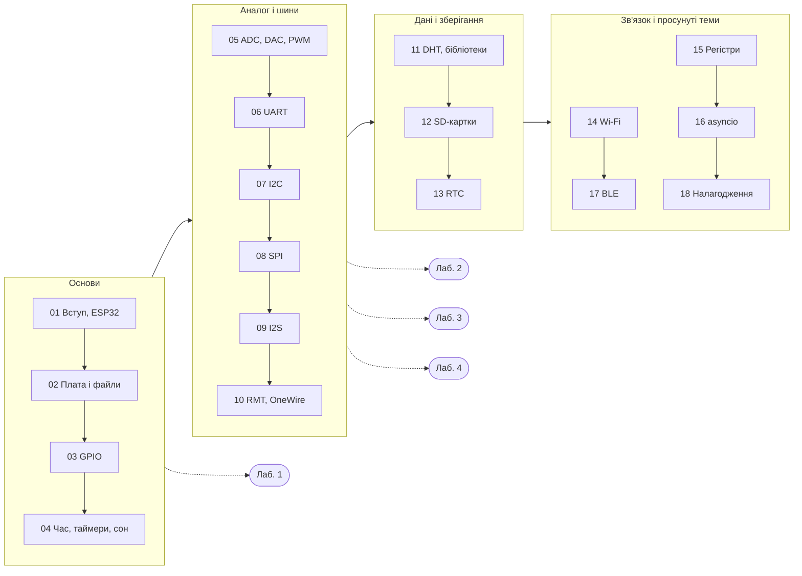

<div align="center">

# 🔌 MicroPython на ESP32

**Інтерактивний конспект лекцій і лабораторні роботи українською мовою**

Національний університет «Чернігівська політехніка»

[](https://mybinder.org/v2/gh/vim4all/Lectures_MicroPython_for_ESP32/HEAD?labpath=Lecture_Course_MicroPython_ESP32.ipynb)
[](https://colab.research.google.com/github/vim4all/Lectures_MicroPython_for_ESP32/blob/main/Lecture_Course_MicroPython_ESP32.ipynb)
[](https://github.com/vim4all/Lectures_MicroPython_for_ESP32/releases/latest)
[](https://github.com/vim4all/Lectures_MicroPython_for_ESP32/actions/workflows/notebooks.yml)


</div>

---

**Викладач:** Пахалюк Богдан Петрович, доктор філософії

**Дисципліна:** Застосування скриптових мов програмування у телекомунікаційних системах — частина «MicroPython на ESP32»

**Мова викладання:** українська

## ✨ Що всередині

Курс складається з **однієї книги-конспекту** (19 розділів в одному Jupyter-зошиті) та **чотирьох лабораторних робіт**.

- 📖 **Теорія** від GPIO і таймерів до шин I2C/SPI/I2S, Wi-Fi, BLE та asyncio — оригінальний матеріал, а не переклад документації
- 🔌 **Електричні схеми**, побудовані кодом у [SchemDraw](https://schemdraw.readthedocs.io/) з умовними позначеннями за ДСТУ/IEC: підтяжки входів, захист пінів, шини I2C, SPI, OneWire, з'єднання UART
- 📈 **Часові діаграми** протоколів (UART, I2C, SPI, I2S, OneWire, DHT) з правильними фронтами, бітами й тривалостями
- 💻 **Приклади коду MicroPython** у кожному розділі
- ❓ **Питання для самоперевірки** з відповідями в кінці кожного розділу
- 🧪 **Лабораторні роботи**: приклад коду, схема підключення, ~10 вправ на кожне завдання; перевірка на реальній платі або в симуляторі [Wokwi](https://wokwi.com)
- 📥 **PDF-версії** конспекту й лабораторних для читання без Jupyter і друку

## 📥 Завантажити PDF

Готові PDF-версії не зберігаються в репозиторії: вони публікуються як файли [релізу](../../releases/latest).

- 📘 [Конспект лекцій (PDF)](../../releases/latest/download/Lecture_Course_MicroPython_ESP32.pdf)
- 🧪 Лабораторні роботи: [№1](../../releases/latest/download/Lab_work_1.pdf) · [№2](../../releases/latest/download/Lab_work_2.pdf) · [№3](../../releases/latest/download/Lab_work_3.pdf) · [№4](../../releases/latest/download/Lab_work_4.pdf)

## 🗺️ Карта курсу



## 📚 Зміст конспекту

> Конспект — один зошит [`Lecture_Course_MicroPython_ESP32.ipynb`](Lecture_Course_MicroPython_ESP32.ipynb). Відкрийте його на GitHub або запустіть у [Binder](https://mybinder.org/v2/gh/vim4all/Lectures_MicroPython_for_ESP32/HEAD?labpath=Lecture_Course_MicroPython_ESP32.ipynb) чи [Google Colab](https://colab.research.google.com/github/vim4all/Lectures_MicroPython_for_ESP32/blob/main/Lecture_Course_MicroPython_ESP32.ipynb) (без встановлення, у браузері).

| № | Розділ | Ключові питання |
|:---:|---|---|
| **01** | Вступ: мікроконтролери, ESP32 та MicroPython | мікроконтролер проти мікрокомп'ютера, архітектура ESP32, прошивка, REPL |
| **02** | Керування платою та файлова система | boot.py і main.py, розділи flash, копіювання файлів, знос flash |
| **03** | Піни та GPIO | обмеження пінів, підтяжки PULL_UP/PULL_DOWN, переривання, PCNT, захист входів, дребезг |
| **04** | Час, таймери та керування живленням | ticks_ms і ticks_diff, machine.Timer, WDT, light і deep sleep |
| **05** | Аналогові інтерфейси: ADC, DAC, PWM | дискретизація й квантування, ШІМ, RC-фільтр, калібрування, теорема Котельникова |
| **06** | UART | кадр, парність, швидкість, з'єднання TX/RX, протокол з контрольною сумою |
| **07** | Шина I2C | START/STOP і ACK, резистори підтяжки, діагностика, мультиплексор, clock stretching |
| **08** | Шина SPI | CS, MOSI/MISO, режими CPOL/CPHA, кілька пристроїв на шині, JEDEC ID |
| **09** | Шина I2S та цифровий звук | BCK/WS/SD, DMA і буфери, формати вибірок, мікрофон |
| **10** | RMT, OneWire, адресні світлодіоди, ємнісні дотики | DS18B20, RESET/PRESENCE, кодування біт WS2812, touch-піни |
| **11** | Давачі DHT і зовнішні бібліотеки | протокол DHT, контрольна сума, встановлення драйверів, I2C-давачі |
| **12** | SD-картки та зберігання даних | SPI і монтування, файлові системи, ротація логів |
| **13** | Реальний час: RTC | вбудований RTC, DS3231, NTP, RTC-пам'ять під час сну |
| **14** | Wi-Fi, мережа та WebREPL | STA і AP, HTTP, WebREPL, безпека, MQTT, вебсервер |
| **15** | Прямий доступ до регістрів | machine.mem32, GPIO_OUT_REG, рівні абстракції, factory reset |
| **16** | Асинхронне програмування (asyncio) | корутини, цикл подій, життєвий цикл задачі, gather і скасування |
| **17** | Bluetooth Low Energy | GATT, сервіси й характеристики, notify, реклама, сканування |
| **18** | Налагодження та надійність коду | traceback, ієрархія винятків, логування, WDT, assert |
| **19** | Підсумки, глосарій і література | карта курсу, терміни, куди рухатись далі |

## 🧪 Лабораторні роботи

| № | Тема | Завдання | Розділи конспекту |
|:---:|---|---|:---:|
| **1** | [Цифрові входи/виходи (GPIO)](Lab_work_1.ipynb) | блимання LED, кнопка, антидребезг, «біжучий вогник», світлофор | 1–3 |
| **2** | [АЦП та ШІМ](Lab_work_2.ipynb) | потенціометр, «дихання» LED, зумер, сервопривід | 5 |
| **3** | [Таймери, переривання та UART](Lab_work_3.ipynb) | лічильник через IRQ, Timer, обмін з ПК і між двома ESP32 | 3, 4, 6 |
| **4** | [Шини I2C та SPI](Lab_work_4.ipynb) | сканування I2C, OLED-дисплей, MAX7219, панель приладів | 7, 8 |

Код лабораторних — це MicroPython, який виконується **на платі ESP32**, а не на комп'ютері. Тому Binder і Colab для них не підходять: використовуйте Jupyter з [`jupyter_micropython_kernel`](https://github.com/goatchurchprime/jupyter_micropython_kernel) і реальну плату або симулятор [Wokwi](https://wokwi.com) — обидва способи докладно описано в кожній роботі.

## 🧭 Як читати конспект

Код, що будує схеми й діаграми, **згорнуто**, щоб не відволікати від матеріалу; розгорнути його можна, натиснувши «⋯» ліворуч від комірки. У PDF показано лише самі рисунки. Приклади MicroPython наведено як звичайний текст коду — їх запускають на платі.

| Позначка | Значення | | Позначка | Значення |
|:---:|---|---|:---:|---|
| 📘 | Розділ конспекту | | 🧪 | Лабораторна робота |
| ❓ | Питання для самоперевірки | | 📝 | Завдання лабораторної |
| 🎯 | Мета роботи | | 🔢 | Вправи для самостійного виконання |

## 🚀 Запуск

**Онлайн:** натисніть [](https://mybinder.org/v2/gh/vim4all/Lectures_MicroPython_for_ESP32/HEAD?labpath=Lecture_Course_MicroPython_ESP32.ipynb) — середовище з усіма бібліотеками збереться автоматично (перший запуск триває кілька хвилин).

**Google Colab:** натисніть [](https://colab.research.google.com/github/vim4all/Lectures_MicroPython_for_ESP32/blob/main/Lecture_Course_MicroPython_ESP32.ipynb). Перша комірка з кодом сама встановить schemdraw; потрібен обліковий запис Google.

**Локально** (Linux / WSL / macOS):

```bash
git clone https://github.com/vim4all/Lectures_MicroPython_for_ESP32.git
cd Lectures_MicroPython_for_ESP32
pip install -r requirements.txt jupyterlab
jupyter lab
```

Для лабораторних на реальній платі додатково: `pip install jupyter_micropython_kernel` і `python -m jupyter_micropython_kernel.install`.

<details>
<summary><b>🛠️ Для викладача: перевірка конспекту й PDF</b></summary>

Перед публікацією зошити перевіряються: структура (заголовки розділів, рамки самоперевірки, приховані комірки діаграм) і виконання конспекту без помилок, причому кожна комірка діаграми має дати рівно один рисунок. Те саме автоматично виконується в GitHub Actions після кожного push.

```bash
python tools/check_notebooks.py            # структура + виконання конспекту
python tools/check_notebooks.py --no-exec  # лише структура (швидко)
python tools/check_notebooks.py --inplace  # також зберегти рисунки в зошиті (після зміни діаграм)
```

PDF-версії генеруються з уже виконаних зошитів (повторне виконання не потрібне); потрібні `xelatex` і `pandoc`:

```bash
sudo apt install texlive-xetex texlive-latex-extra texlive-fonts-recommended pandoc fonts-dejavu
pip install nbconvert
python tools/regenerate_pdfs.py                  # усі PDF -> pdf/
python tools/regenerate_pdfs.py Lecture          # лише вибрані
python tools/regenerate_pdfs.py --setup-jupyter  # той самий шаблон для «Export as PDF» у Jupyter
```

Щоб опублікувати новий реліз, достатньо створити тег версії — GitHub Actions збере всі PDF і прикріпить їх до релізу:

```bash
git tag v1.0.0 && git push origin v1.0.0
```

Структура репозиторію:

```
Lecture_Course_MicroPython_ESP32.ipynb  конспект лекцій (19 розділів)
Lab_work_1.ipynb … Lab_work_4.ipynb     лабораторні роботи (MicroPython, виконуються на платі)
requirements.txt, runtime.txt           залежності Python (також для Binder)
tools/check_notebooks.py                перевірка структури й виконання зошитів
tools/regenerate_pdfs.py                експорт зошитів у PDF
.github/workflows/                      перевірка зошитів і збирання PDF для релізу в GitHub Actions
```

</details>

---

<div align="center">

*Конспект підготовлено: Пахалюк Богдан Петрович, НУ «Чернігівська політехніка»*

</div>
